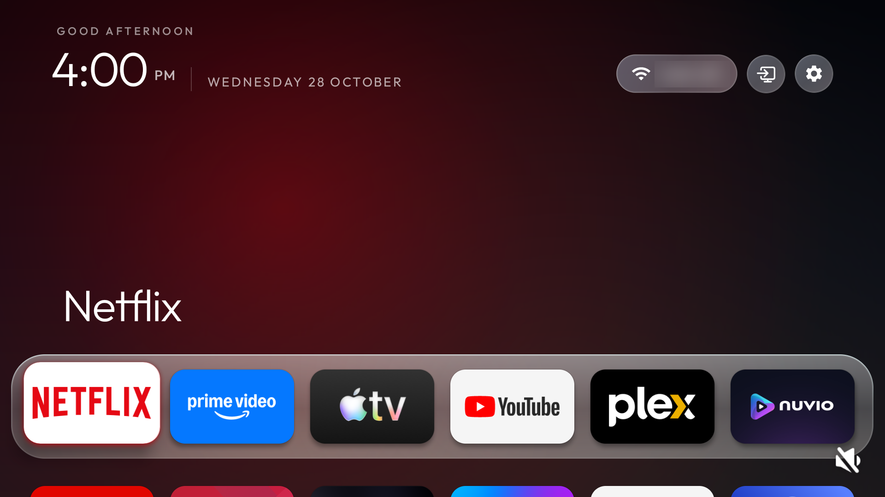
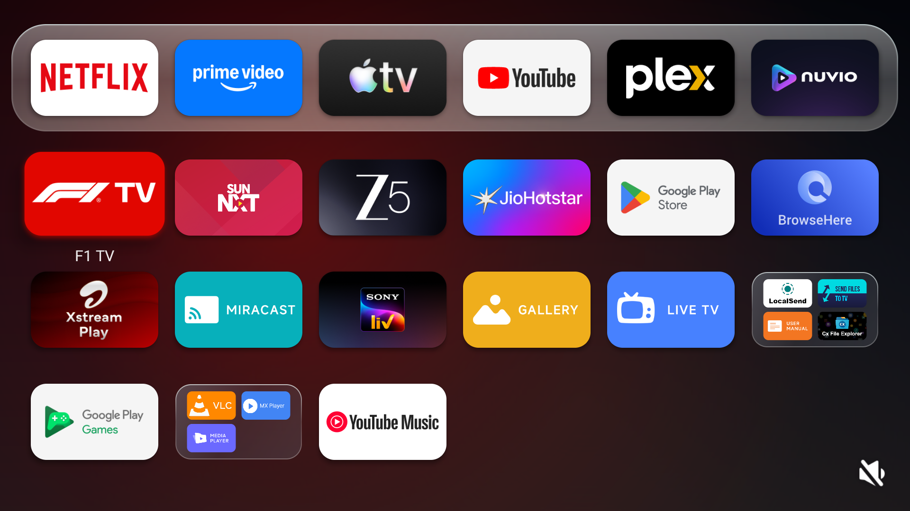
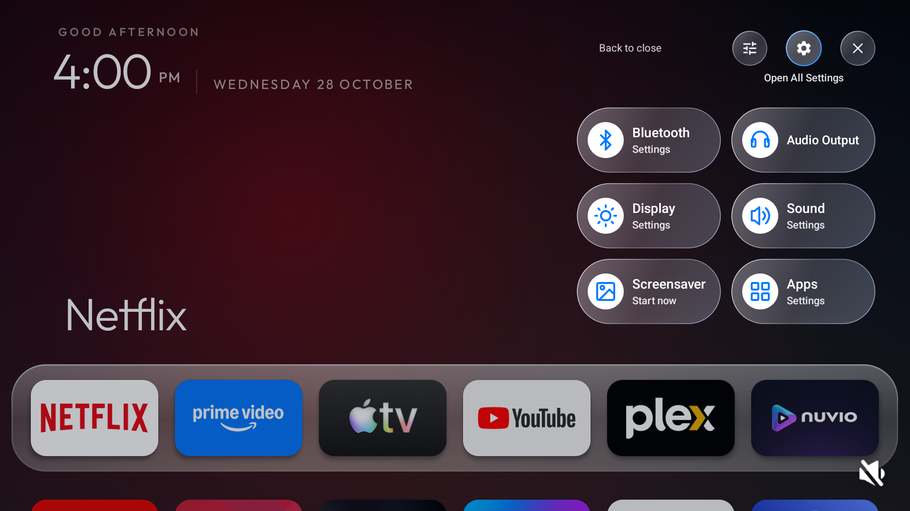
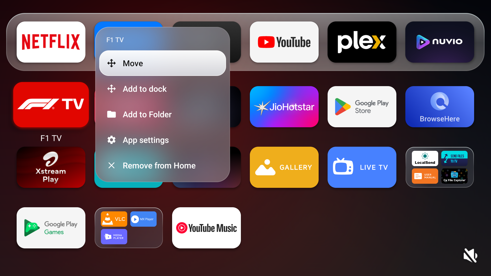
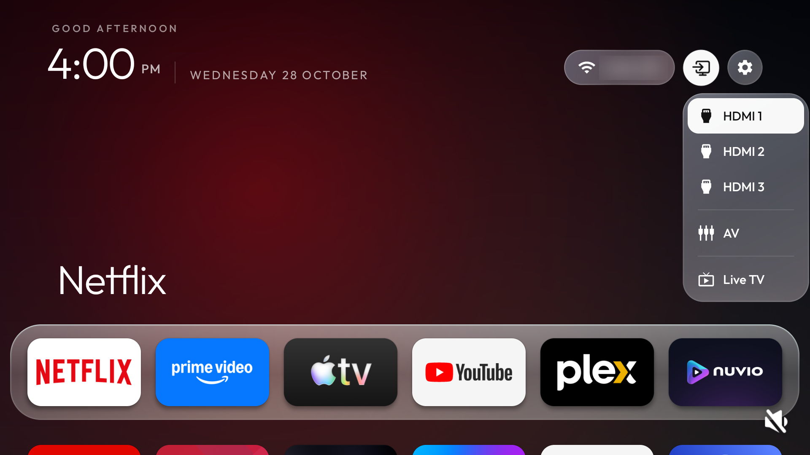
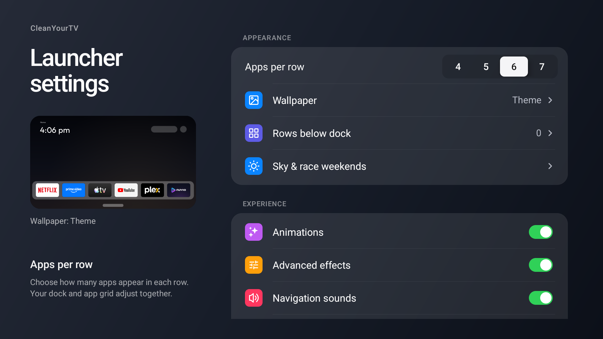

<h1 align="center">Apple TV OS Launcher</h1>

<p align="center"><strong>A tvOS-inspired home for Android TV and Google TV.</strong></p>

<p align="center">A floating glass dock. Your apps, arranged your way.<br>Soft frosted menus and settings that feel like part of Home.</p>

<p align="center">
  <a href="#explore-the-interface">Explore the interface</a> ·
  <a href="#make-it-yours">Make it yours</a> ·
  <a href="#remote-controls">Remote controls</a> ·
  <a href="#build-and-install">Build &amp; install</a>
</p>



A home screen built around the apps you actually use. Pin your favorites to the dock, put the rest in folders, and move between everything with your TV remote. Rounded artwork, soft borders, translucent surfaces and clear focus states carry through the whole interface.

**These are captures from the current launcher on a physical Xiaomi TV running Android 14, taken on 28 October 2026.** The Wi-Fi name is obscured in the public images. The app layout, menus and settings are shown as they were on the TV.

## Explore the interface

### Home, then all your apps

Keep your favorites in the glass dock. Press **Down** once to bring the full app grid into view, with folders alongside individual apps. Press **Up** from the dock to reach the header controls.



### Quick settings without leaving Home

The gear opens six large glass tiles for **Bluetooth**, **Audio Output**, **Display**, **Sound**, **Screensaver** and **Apps**. The controls above them open launcher settings, all TV settings, or close the panel.



### Hold an app to make it yours

Hold **OK**, or press the remote's **Menu** key, to open the app's frosted action menu. Move it, add it to the dock, put it in a folder, open its app settings, or remove its Home shortcut. Dock apps also offer a replacement action so you can swap a favorite without rearranging everything.



### Inputs, one icon away

The compact source icon sits between Wi-Fi and Settings. Its matching glass menu brings together the TV's available inputs and Live TV. The options shown depend on the TV.



### Settings with a view of Home

Open the gear, then choose the **sliders icon** to enter Launcher settings. Grouped controls and a live miniature of Home help you see how layout and appearance changes fit together.



## Make it yours

| Your Home | What you can change |
|---|---|
| **Layout** | Choose 4–7 apps per row, set the rows visible below the dock, arrange apps, and create folders. |
| **App Library** | Browse installed apps. OK opens an app; hold OK to add or remove its Home shortcut. |
| **Artwork & names** | Rename tiles, choose built-in artwork, borrow another app's icon, or import your own image. |
| **Wallpaper & glass** | Use a theme, Aurora, one of 14 bundled Scenes, or a rotating collection. Adjust dimming and dock opacity. |
| **Motion & sound** | Choose animations, advanced effects and navigation sounds. |
| **Ambient details** | Set up the idle clock, city-based sky effects and the optional race-weekend panel. |
| **Continue Watching** | Enable a shelf above the dock for unfinished items published by the selected app. Apps with no eligible items show no shelf. |
| **Remote buttons** | Learn a supported physical button and assign an app. The optional accessibility helper extends mappings beyond Home. |

Personal app names, artwork, folders and ordering survive theme changes. Continue Watching depends on what each media app publishes through Android TV; it does not read private streaming accounts. City search, race-calendar updates and some media thumbnails use the network. Home navigation, bundled wallpapers and the clock work offline.

Read the [feature guide](docs/features.md), [App Library guide](docs/app-library.md), and [theme configuration reference](themes/README.md) for details.

## Remote controls

| Button | On Home |
|---|---|
| **D-pad** | Move between apps, folders and controls. |
| **OK** | Open the selected app, folder or control. |
| **Hold OK / Menu** | Open actions for the selected app. |
| **Down from the dock** | Expand the app grid. |
| **Up from the dock** | Reach the header, or the Continue Watching shelf when it has items. |
| **Back** | Close the current menu or folder and return to the previous view. |

## Build and install

For **Android TV and Google TV running Android 8.0 or later** (API 26+). Use a full **JDK 17**, Android SDK **platform 34**, and **build-tools 34.0.0**. Set `ANDROID_HOME` to your SDK location, or set `sdk.dir` in `launcher/local.properties`.

```bash
git clone https://github.com/iyashwant/apple-tv-os-launcher.git
cd apple-tv-os-launcher/launcher
./gradlew --no-daemon assembleRelease
```

The APK is written to `launcher/app/build/outputs/apk/release/app-release.apk` from the repository root. With an authorized ADB connection, install it from that root:

```bash
export TV_ENDPOINT='<tv-ip>:<adb-port>'
adb connect "$TV_ENDPOINT"
adb -s "$TV_ENDPOINT" install -r launcher/app/build/outputs/apk/release/app-release.apk
```

For a TV that uses Wireless debugging, [pair and connect first](tools/native-adb.md). Open the launcher and check that your remote and inputs work, then select it in the TV's default Home settings where supported. Keep the stock launcher available. Updates to an existing install must use the same signing key; the Android package remains `com.gathin.tvhome`.

### Working on the launcher

The custom launcher lives on **`main`**. Java source and Android resources are in [`launcher/`](launcher/); visual presets and wallpapers are in [`themes/`](themes/). To check a launcher change, run this from `launcher/`:

```bash
./gradlew --no-daemon testReleaseUnitTest lintRelease assembleRelease
```

Follow the [agent instructions](AGENTS.md) when working in this repository. For bugs and ideas, [open an issue](https://github.com/iyashwant/apple-tv-os-launcher/issues).

## Credits & upstream

Based on [CleanYourTV](https://github.com/Gathin23/cleanyourtv) by Gathin and its contributors, with an independently maintained Apple-inspired interface. Upstream changes are reviewed and merged manually; see the [integration record](docs/upstream-integration.md). The inherited device-maintenance documentation is kept in the [reference guide](README.upstream.md). Released under the [MIT license](LICENSE). Unofficial; not affiliated with Apple.
